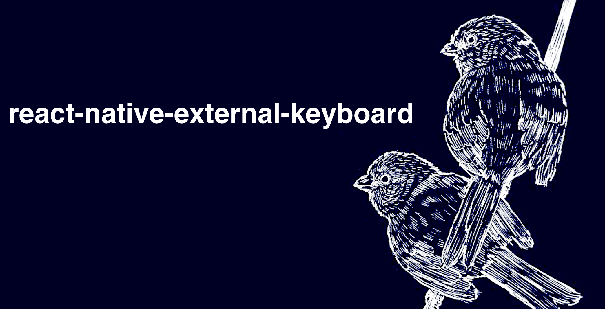
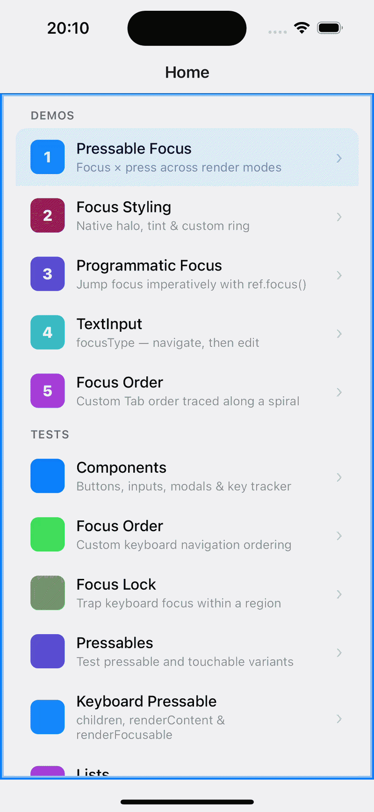

# React Native External Keyboard

<div>
  
</div>

Physical keyboard support for React Native on iOS and Android, from focus management and key handling to platform features.

This package is designed to improve physical keyboard UX via a set of tools:
- **Keyboard focus** — focusable views, focus and blur events, `autoFocus`, and focus requests through a `ref`.
- **Focus styling** — configurable iOS halo and Android default focus highlight, and styles driven by `focused` and `pressed` state.
- **Focus order** — custom Tab and arrow-key paths based on links, indexes, or direction locks.
- **Focus guide** — a `UIFocusGuide`-style redirect for iOS and Android: focus that enters an area moves on to a chosen view.
- **Focus lock** — focus containment for modals, sheets, and overlays, including VoiceOver and TalkBack.
- **Key events** — key-down and key-up handlers with key codes and modifier state.
- **Focus groups** *(iOS)* — `focusGroupIdentifier` support for Tab navigation between groups.
- **Text input** — configurable focus and blur behavior for text fields.

## Installation

```sh
npm install react-native-external-keyboard
cd ios && pod install
```

## Compatibility

| Library version | React Native | Architecture |
| :-- | :-- | :-- |
| `2.x` | ≥ 0.87 | New Architecture |
| `1.x` | 0.80 – 0.86 | New and Old Architecture |
| `0.x` | ≤ 0.79 | New and Old Architecture |

The package contains native code; for this reason, Expo is supported with the [prebuild](https://docs.expo.dev/guides/adopting-prebuild/) option only. Setup steps: [Expo](./docs/getting-started/getting-started.md#expo).

## Usage

### Focusable components

The package provides the `K` namespace that contains keyboard-focusable replacements for core components: `K.Pressable`, `K.View`, and `K.Input`. These components extend their core counterparts with focus and blur events, key press handling, focus order props, and styles driven by `focused` state.

```tsx
import { K } from 'react-native-external-keyboard';
import { Text } from 'react-native';

<K.Pressable
  autoFocus
  onPress={onPress}
  style={({ focused }) => focused && { backgroundColor: 'dodgerblue' }}
>
  <Text>Press me with Space or Enter</Text>
</K.Pressable>
```

### Focus requests

For requesting and managing keyboard focus on a specific component, the package provides an imperative API through the component `ref`:

| Method | Moves |
| :-- | :-- |
| `focus()` | Keyboard and screen reader focus |
| `keyboardFocus()` | Keyboard focus only |
| `screenReaderFocus()` | Screen reader focus only (VoiceOver / TalkBack) |

```tsx
import { useRef } from 'react';
import { Text } from 'react-native';
import { K, type KeyboardFocus } from 'react-native-external-keyboard';

export function Form({ onSubmit }: { onSubmit: () => void }) {
  const submitRef = useRef<KeyboardFocus>(null);

  return (
    <>
      <K.Pressable onPress={() => submitRef.current?.focus()}>
        <Text>Skip to Submit</Text>
      </K.Pressable>

      <K.Pressable ref={submitRef} onPress={onSubmit}>
        <Text>Submit</Text>
      </K.Pressable>
    </>
  );
}
```

### Key events

Key events on a focused component arrive through `onKeyDownPress` (key pressed) and `onKeyUpPress` (key released). Both handlers receive the key details in `e.nativeEvent`:

| Field | Value |
| :-- | :-- |
| `keyCode` | Platform key code (values differ between iOS and Android) |
| `unicodeChar` / `unicode` | Typed character, as a string and as a code point |
| `isShiftPressed` / `isAltPressed` / `isCtrlPressed` | Modifier state |
| `isCapsLockOn` | Caps Lock state |
| `hasNoModifiers` | `true` when no modifier key is held |
| `isLongPress` | Long press flag, set on key up |

```tsx
<K.Pressable
  onPress={onOpen}
  onKeyUpPress={(e) => {
    const { unicodeChar, hasNoModifiers } = e.nativeEvent;
    if (unicodeChar === 'd' && hasNoModifiers) onDelete();
  }}
>
  <Text>Open document</Text>
</K.Pressable>
```

`onPress` stays the activation handler for Space and Enter; key events cover any other key.


### Custom components

`K.Pressable` is built with the [`withKeyboardFocus`](./docs/components/overview.md#withkeyboardfocus) HOC, which brings the same focus and key handling to custom and third-party components, such as `TouchableOpacity`:

```tsx
import { withKeyboardFocus } from 'react-native-external-keyboard';
import { TouchableOpacity } from 'react-native';

const KeyboardTouchable = withKeyboardFocus(TouchableOpacity);
```


## Documentation

The full list of components, features, and API can be found in the [Documentation](./docs/README.md). The [getting started guide](./docs/getting-started/getting-started.md) covers setup and the first focusable components.

### Components

| Export | Purpose |
| :-- | :-- |
| [`K.Pressable` / `K.View` / `K.Input`](./docs/getting-started/getting-started.md#quick-start) | Keyboard-focusable `Pressable`, `View`, and `TextInput` |
| [`K.Order`](./docs/components/overview.md#korder) | Scope for index-based focus order |
| [`K.GroupIdentifierProvider`](./docs/components/overview.md#kgroupidentifierprovider) | iOS focus group scope without a native view |
| [`K.FocusGroup`](./docs/components/overview.md#kfocusgroup) | iOS focus group with `focusGroupIdentifier` and `tintColor` |
| [`K.Guide`](./docs/components/overview.md#kguide) | Focus redirection from an area to a chosen view |
| [`Focus.Frame` / `Focus.Trap`](./docs/components/overview.md#focusframe--focustrap) | Focus containment for modals, sheets, and overlays |
| [`withKeyboardFocus`](./docs/components/overview.md#withkeyboardfocus) | HOC that adds keyboard focus to `Pressable`- and `Touchable`-like components |

### Styling

- [Focus styles and events](./docs/guides/pressable-focus.md): `style` and `containerStyle` driven by `focused` and `pressed` state, render props, focus and blur events
- [Native focus indicators](./docs/guides/focus-styling.md): iOS halo, Android default focus highlight. iOS: `haloEffect`, `tintColor`, `halo*`; Android: `defaultFocusHighlightEnabled`; both: `tintType`
- [Hooks](./docs/api/overview.md#hooks): `useIsViewFocused` and `useIsViewPressed` for focus- and press-aware children

### Key handling

- [Key events](./docs/api/overview.md#keypress): `onKeyDownPress` and `onKeyUpPress` payload
- [Activation keys](./docs/components/overview.md#withkeyboardfocus): `triggerCodes` for `onPress` and `onLongPress`
- [Keyboard module](./docs/api/overview.md#keyboard-module): soft keyboard dismissal from a hardware keyboard

### Focus order and management

- [Programmatic focus](./docs/guides/programmatic-focus.md): `ref.focus()`, `keyboardFocus()`, `screenReaderFocus()`, `autoFocus`
- [Focus order](./docs/guides/focus-order.md): links between views, index order, and locked directions
- [Focus lock](./docs/guides/focus-lock.md): `Focus.Frame` and `Focus.Trap` for modals, sheets, and overlays
- [Focus guide](./docs/guides/focus-guide.md): `K.Guide`, focus order through redirection to a chosen view
- [Text input](./docs/guides/text-input.md): focus and blur behavior of text fields (`focusType`, `blurType`)

### Native features

- [Focus groups](./docs/guides/keyboard-grouping.md) *(iOS)*: `focusGroupIdentifier`, `uniqueGroupIdentifier`, `K.GroupIdentifierProvider`, `Keyboard.configure`
- [Native focus services](./docs/guides/native-focus-services.md): native-side focus API for custom iOS and Android code

### Reference

- [Component overview](./docs/components/overview.md): every component and its props
- [API reference](./docs/api/overview.md): modules, hooks, the imperative ref, shared types
- [Migration guide](./docs/migration/migration.md): version upgrade notes

---

## Contributing

Any type of contribution is highly appreciated. Feel free to create PRs, raise issues, or share ideas — see the [contributing guide](CONTRIBUTING.md) for the development workflow.

## Acknowledgements

It has been a long journey since the first release of the `react-native-external-keyboard` package. Many features have been added, and a lot of issues have been fixed.

With that, I would like to thank the contributors, those who created issues, and the followers, because achieving these results wouldn't have been possible without you.

Thanks to the initial authors: [Andrii Koval](https://github.com/ZioVio), [Michail Chavkin](https://github.com/mchavkin), [Dzmitry Khamitsevich](https://github.com/bulletxenus).

Thanks to the contributors: [João Mosmann](https://github.com/JoaoMosmann), [Stéphane](https://github.com/stephane-r).

Thanks to those who created issues: [Stéphane](https://github.com/stephane-r), [proohit](https://github.com/proohit), [Rananjaya Bandara](https://github.com/Rananjaya), [SteveHoneckPGE](https://github.com/SteveHoneckPGE), [Wes](https://github.com/mrpoodestump).

I really appreciate your help; it has truly helped me move forward!

## License

MIT

---

Made with [create-react-native-library](https://github.com/callstack/react-native-builder-bob)
