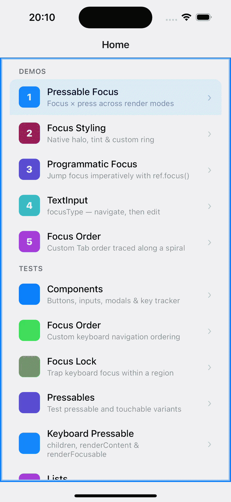
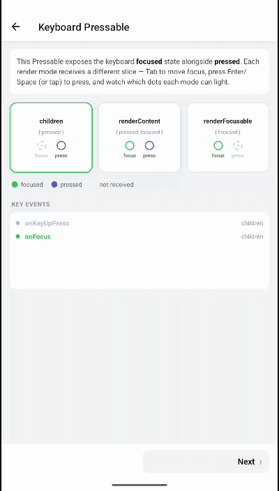

# Documentation

Physical keyboard support for React Native on iOS and Android, from focus management and key handling to platform features.

| iOS | Android |
| --- | --- |
|  |  |

- [Getting started](#getting-started)
- [Guides](#guides)
- [Components](#components)
- [API reference](#api-reference)
- [Migration](#migration)

## Getting started

```sh
npm install react-native-external-keyboard
cd ios && pod install
```

The `K` namespace provides keyboard-focusable replacements for `Pressable`, `View`, and `TextInput`:

```tsx
import { K } from 'react-native-external-keyboard';

<K.Pressable
  onPress={onPress}
  style={({ focused }) => focused && { backgroundColor: 'dodgerblue' }}
>
  <Text>Press me with Space or Enter</Text>
</K.Pressable>
```

The [`withKeyboardFocus`](./components/overview.md#withkeyboardfocus) HOC brings the same focus and key handling to custom and third-party components.

More on installation, compatibility, and Expo setup: [Getting started guide](./getting-started/getting-started.md).

## Guides

Task-focused walkthroughs, grouped by topic.

### Styling

| Guide | Covers |
| :-- | :-- |
| [Focus styles and events](./guides/pressable-focus.md) | `style` / `containerStyle` driven by `focused` and `pressed` state, `renderContent`, `renderFocusable`, focus and blur events |
| [Native focus indicators](./guides/focus-styling.md) | iOS halo, Android default focus highlight. iOS: `haloEffect`, `tintColor`, `halo*`; Android: `defaultFocusHighlightEnabled`; both: `tintType` |

### Focus order and management

| Guide | Covers |
| :-- | :-- |
| [Programmatic focus](./guides/programmatic-focus.md) | `ref.focus()`, `keyboardFocus()`, `screenReaderFocus()`, `autoFocus` |
| [Focus order](./guides/focus-order.md) | Links between views, index order, and locked directions |
| [Focus guide](./guides/focus-guide.md) | `K.Guide`: focus that enters an area moves on to a chosen view |
| [Focus lock](./guides/focus-lock.md) | `Focus.Frame`, `Focus.Trap`: focus containment for modals, sheets, and overlays |
| [Text input](./guides/text-input.md) | `K.Input`, `focusType`, `blurType` |

### Native features

| Guide | Covers |
| :-- | :-- |
| [Focus groups](./guides/keyboard-grouping.md) | iOS focus groups: `uniqueGroupIdentifier`, `K.GroupIdentifierProvider`, `Keyboard.configure` |

## Components

Descriptions, usage notes, and full props tables: [Component overview](./components/overview.md).

| Component | Purpose |
| :-- | :-- |
| [`K.Pressable` / `K.View` / `K.Input`](./getting-started/getting-started.md#quick-start) | Keyboard-focusable `Pressable`, `View`, and `TextInput` |
| [`K.Order`](./components/overview.md#korder) | Scope for index-based focus order |
| [`K.GroupIdentifierProvider`](./components/overview.md#kgroupidentifierprovider) | iOS focus group scope without a native view |
| [`K.FocusGroup`](./components/overview.md#kfocusgroup) | iOS focus group with `focusGroupIdentifier` and `tintColor` |
| [`K.Guide`](./components/overview.md#kguide) | Focus redirection from an area to a chosen view |
| [`Focus.Frame` / `Focus.Trap`](./components/overview.md#focusframe--focustrap) | Focus containment for modals, sheets, and overlays |
| [`withKeyboardFocus`](./components/overview.md#withkeyboardfocus) | HOC that adds keyboard focus to `Pressable`- and `Touchable`-like components |

## API reference

Modules, the HOC contract, hooks, the imperative ref, and shared types: [API overview](./api/overview.md).

| Item | Purpose |
| :-- | :-- |
| [`KeyboardFocus` ref](./api/overview.md#imperative-ref-keyboardfocus) | Imperative focus requests: `focus`, `keyboardFocus`, `screenReaderFocus` |
| [`Keyboard`](./api/overview.md#keyboard-module) | Soft keyboard dismissal and app-wide defaults (`Keyboard.configure`) |
| [`withKeyboardFocus`](./api/overview.md#withkeyboardfocus-hoc) | HOC factory contract and render props |
| [Hooks](./api/overview.md#hooks) | `useIsViewFocused`, `useIsViewPressed`, `useOrderFocusGroup` |
| [Focus order props](./guides/focus-order.md#props) | `orderId`, `order*`, `orderIndex`, `orderGroup`, `lockFocus` |
| [Default key behavior](./api/overview.md#default-key-behavior) | Focus movement, `onPress` and `onLongPress` keys per platform |
| [Key events](./api/overview.md#keypress) | `KeyPress` payload of `onKeyDownPress` / `onKeyUpPress` |
| [Types](./api/overview.md#types) | `KeyPress`, `OnKeyPress`, `FocusStyle`, `LockFocusType`, and other shared types |

## Migration

Upgrade notes, newest first: [Migration guide](./migration/migration.md).

| Upgrade | Highlights |
| :-- | :-- |
| [0.13.x → 0.14.0](./migration/migration.md#migrating-to-0140-from-013x) | iOS: no unique focus group per view by default; opt-in `uniqueGroupIdentifier`; `Tab` moves between groups, `Ctrl + Tab` within; `K` names for every component |
| [0.9.1 → 1.0.0](./migration/migration.md#migrating-to-100-from-091) | Prop and type renames (`group` → `focusableWrapper`, `canBeFocused` → `focusable`), new ref methods, `K` namespace |
| [0.9.0 → 0.9.1](./migration/migration.md#migrating-to-091-from-090) | `disabled` suppresses keyboard-triggered presses <!-- TODO: confirm — no `disabled` handling found in src/; iOS key-up calls onPress regardless --> |
| [0.7.x → 0.8.0](./migration/migration.md#migrating-to-080-from-07x) | RN 0.83 / 0.84 type compatibility through the HOC |
| [0.3.x → 0.4.0](./migration/migration.md#migrating-to-040-from-03x) | Module functions → `ref` actions; `Pressable` → `withKeyboardFocus` |
