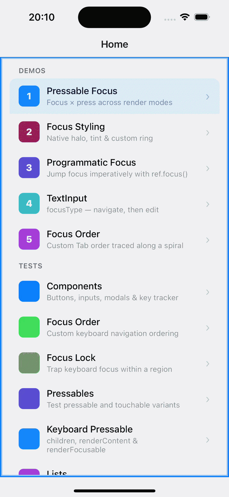
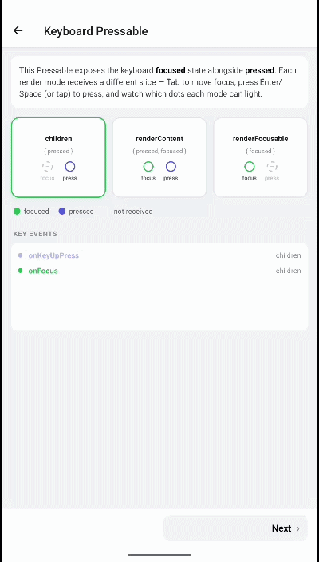

# Getting started

Physical keyboard support for React Native on iOS and Android, from focus management and key handling to platform features.

| iOS | Android |
| --- | --- |
|  |  |

## Compatibility

| Library version | React Native | Architecture |
| :-- | :-- | :-- |
| `2.x` | ≥ 0.87 | New Architecture |
| `1.x` | 0.80 – 0.86 | New and Old Architecture |
| `0.x` | ≤ 0.79 | New and Old Architecture |

## Installation

```sh
npm install react-native-external-keyboard
# or
yarn add react-native-external-keyboard
```

### iOS

```sh
cd ios && pod install && cd ..
```

### Expo

The package contains native code; for this reason, Expo is supported with the [prebuild](https://docs.expo.dev/guides/adopting-prebuild/) option only.

```sh
npx expo prebuild

# Build and run the native app
npx expo run:ios
npx expo run:android
```

## Quick start

For better visibility, the `K` namespace includes the components for most of the package's features. Three of them are keyboard-focusable replacements for core components:

| Component | Replaces | Typical use |
| :-- | :-- | :-- |
| `K.Pressable` | `Pressable` | Buttons and tappable rows |
| `K.View` | `View` | Focusable containers and key handling |
| `K.Input` | `TextInput` | Text fields |

```tsx
import { K } from 'react-native-external-keyboard';
import { Text } from 'react-native';

export default function App() {
  return (
    <K.Pressable
      autoFocus
      onPress={() => console.log('activated')}
      onFocus={() => console.log('focused')}
      onBlur={() => console.log('blurred')}
      style={({ focused }) => focused && { backgroundColor: 'dodgerblue' }}
    >
      <Text>Press me with Space or Enter</Text>
    </K.Pressable>
  );
}
```

The `focused` style and focus events in this example follow changes of keyboard focus, which moves with `Tab` and the arrow keys. More information about platform differences, such as iOS focus groups and long press, is in [Default key behavior](../api/overview.md#default-key-behavior).

### Custom components

`K.Pressable` is built with the `withKeyboardFocus` HOC, which brings the same focus and blur events, focus styling, `autoFocus`, and imperative focus `ref` to custom and third-party components, such as `TouchableOpacity`:

```tsx
import { withKeyboardFocus } from 'react-native-external-keyboard';
import { TouchableOpacity } from 'react-native';

const KeyboardTouchable = withKeyboardFocus(TouchableOpacity);
```

## Common tasks

| Task | API | Guide |
| :-- | :-- | :-- |
| Styles for the focused or pressed state | `style` / `containerStyle` functions, `useIsViewFocused` | [Focus styles and events](../guides/pressable-focus.md) |
| Native focus indicator: iOS halo, Android default focus highlight | iOS: `haloEffect`, `tintColor`, `halo*`; Android: `defaultFocusHighlightEnabled`; both: `tintType` | [Native focus indicators](../guides/focus-styling.md) |
| Focus requests from code | `ref.current?.focus()`, `autoFocus` | [Programmatic focus](../guides/programmatic-focus.md) |
| Keyboard shortcuts | `onKeyDownPress` / `onKeyUpPress` | [`KeyPress` reference](../api/overview.md#keypress) |
| Custom Tab and arrow-key order | `K.Order` + `orderIndex`, `orderId` + `order*` | [Focus order](../guides/focus-order.md) |
| Focus order through redirection to a chosen view | `K.Guide` | [Focus guide](../guides/focus-guide.md) |
| Focus containment in modals and sheets | `Focus.Frame` + `Focus.Trap` | [Focus lock](../guides/focus-lock.md) |
| iOS focus group navigation | `groupIdentifier`, `K.GroupIdentifierProvider`, `K.FocusGroup` | [Focus groups](../guides/keyboard-grouping.md) |
| Text field focus behavior | `K.Input` with `focusType` / `blurType` | [Text input](../guides/text-input.md) |

Full props tables: [Component overview](../components/overview.md) · [API reference](../api/overview.md) · [Documentation](../README.md)

## Aliases

Components in the `K` namespace are also exported under their root names, and some under older names kept for backward compatibility:

| `K` namespace | Root export | Other aliases |
| :-- | :-- | :-- |
| `K.Pressable` | `Pressable` | `KeyboardExtendedPressable` |
| `K.Input` | `KeyboardExtendedInput` | `TextInput` |
| `K.View` | `KeyboardFocusView` | `KeyboardExtendedView` |
| `K.BaseView` | `BaseKeyboardView` | `ExternalKeyboardView`, `KeyboardExtendedBaseView` |
| `K.Order` | `KeyboardOrderFocusGroup` | — |
| `K.GroupIdentifierProvider` | `KeyboardGroupProvider` | — |
| `K.FocusGroup` | `KeyboardFocusGroup` | — |
| `K.Guide` | `KeyboardFocusGuide` | — |
