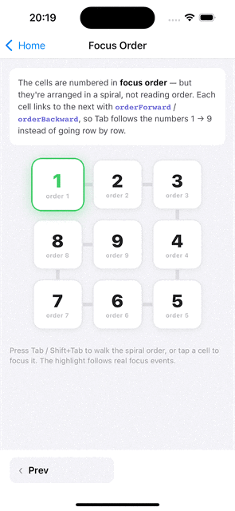
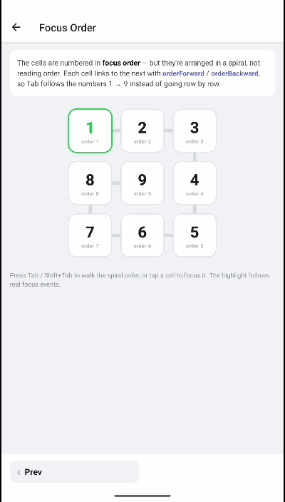

# Focus order

Keyboard focus follows the native view hierarchy by default. When the visual layout differs from that hierarchy, as in grids and columns, three systems set the order instead: links between views, an index within a group, and locked directions. They work on `K.Pressable`, `K.View`, `K.Input`, `K.BaseView`, and `withKeyboardFocus` components and can be combined.

| iOS | Android |
| --- | --- |
|  |  |

## How it works

### Links between views

Each view gets an `orderId`, and its direction props name the `orderId` of the view that receives focus in that direction:

```tsx
<K.Order>
  <K.Pressable orderId="a" orderForward="b" onPress={onPress}>
    <Text>1</Text>
  </K.Pressable>
  <K.Pressable orderId="b" orderBackward="a" orderForward="c" onPress={onPress}>
    <Text>2</Text>
  </K.Pressable>
  <K.Pressable orderId="c" orderBackward="b" onPress={onPress}>
    <Text>3</Text>
  </K.Pressable>
</K.Order>
```

| Prop | Key |
| :-- | :-- |
| `orderForward` / `orderBackward` | `Tab` / `Shift + Tab` |
| `orderLeft` / `orderRight` | Left / right arrow, D-pad |
| `orderUp` / `orderDown` | Up / down arrow, D-pad |
| `orderFirst` / `orderLast` (iOS) | Jump to the first / last element |

Links cover both linear `Tab` flows and two-dimensional arrow-key navigation. `orderFirst` and `orderLast` default to the `orderForward` and `orderBackward` targets, and `null` clears them.

### Unique ids

`orderId` values share one global namespace. For this reason, a component rendered more than once, such as a list row, produces duplicate ids, and focus jumps to the wrong view. `K.Order` gives every `orderId` inside it a namespace of its own:

```tsx
{items.map((item) => (
  <K.Order key={item.id}>
    <K.Pressable orderId="title" orderForward="action" onPress={onPress}>
      <Text>{item.title}</Text>
    </K.Pressable>
    <K.Pressable orderId="action" orderBackward="title" onPress={onPress}>
      <Text>Open</Text>
    </K.Pressable>
  </K.Order>
))}
```

The namespace applies to the view's `orderId` and to all of its `order*` targets, so links inside one namespace keep working. A link prop outside any namespace logs a dev warning.

The generated namespace is not known outside the `K.Order`. A fixed one makes the ids reachable from elsewhere, for example from a [`K.Guide`](./focus-guide.md#target-lookup) with `orderGroup`. `groupId` on `K.Order` sets it for a subtree:

```tsx
<K.Order groupId="card_42">
  <K.Pressable orderId="title" orderForward="action" onPress={onPress}>
    <Text>Title</Text>
  </K.Pressable>
  <K.Pressable orderId="action" orderBackward="title" onPress={onPress}>
    <Text>Open</Text>
  </K.Pressable>
</K.Order>
```

`orderPrefix="card_42"` on a single view has the same effect and takes precedence over the surrounding `K.Order`.

### Index within a group

For a plain sequence, an index is shorter than links. Views with `orderIndex` inside one `K.Order` receive focus in ascending index order, whatever their position in the tree:

```tsx
<K.Order>
  <K.Pressable orderIndex={0} onPress={onPress}>
    <Text>First</Text>
  </K.Pressable>
  <K.Pressable orderIndex={2} onPress={onPress}>
    <Text>Third</Text>
  </K.Pressable>
  <K.Pressable orderIndex={1} onPress={onPress}>
    <Text>Second</Text>
  </K.Pressable>
</K.Order>
```

`K.Order` sets both the index group and the `orderId` namespace, so one wrapper serves both systems. Without the wrapper, `orderGroup` on each view sets the group. An `orderIndex` with no group has no effect and logs a dev warning.

### Locked directions

`lockFocus` blocks focus from leaving a view in the listed directions, for example at the edge of a region:

```tsx
<K.Pressable lockFocus={['down', 'right']} onPress={onPress}>
  <Text>No exit down or right</Text>
</K.Pressable>
```

| Value | Blocks |
| :-- | :-- |
| `'up'` / `'down'` / `'left'` / `'right'` | Arrow-key and D-pad moves |
| `'forward'` / `'backward'` | `Tab` / `Shift + Tab` |
| `'first'` / `'last'` (iOS) | Jump to the first / last element |

On iOS, a blocked `forward` or `backward` move falls back to the first or last element. Locking `first` and `last` as well keeps focus in place.

### Order keys on iOS

On iOS, `Tab` moves between focus groups and `Ctrl + Tab` moves inside a group (see [Focus groups](./keyboard-grouping.md)). For this reason, `orderForward`, `orderBackward`, and index order follow `Ctrl + Tab` / `Ctrl + Shift + Tab` by default and inside a named group. A view that is its own focus group, with `uniqueGroupIdentifier` and no `groupIdentifier`, follows plain `Tab` instead:

```tsx
<K.Pressable uniqueGroupIdentifier orderId="a" orderForward="b" onPress={onPress}>
  <Text>Tab goes to "b"</Text>
</K.Pressable>
```

---

## Quick decision guide

| Need | API |
| :-- | :-- |
| Sequence of sibling views by number | `orderIndex` inside `K.Order` |
| Next view for each key, set on the view focus leaves | `orderId` with `orderForward`, `orderDown`, … |
| Unique ids in repeated content | `K.Order` around each item |
| Fixed namespace, reachable from outside | `K.Order` with `groupId`, or `orderPrefix` |
| No exit in some directions | `lockFocus` |
| One target for every move into an area | `K.Guide` ([Focus guide](./focus-guide.md)) |
| Focus containment for modals and overlays | `Focus.Trap` ([Focus lock](./focus-lock.md)) |

---

## Props

Focus order props of `K.Pressable`, `K.View`, `K.Input`, `K.BaseView`, and `withKeyboardFocus` components:

| Prop | Platform | Type | Default | Description |
| :-- | :-- | :-- | :-- | :-- |
| `orderId` | Both | `string` | — | Id of the view, the target of other views' links. |
| `orderForward` | Both | `string` | — | Target of `Tab`. |
| `orderBackward` | Both | `string` | — | Target of `Shift + Tab`. |
| `orderLeft` | Both | `string` | — | Target of the left arrow. |
| `orderRight` | Both | `string` | — | Target of the right arrow. |
| `orderUp` | Both | `string` | — | Target of the up arrow. |
| `orderDown` | Both | `string` | — | Target of the down arrow. |
| `orderFirst` | iOS | `string \| null` | `orderForward` | Target of a jump to the first element. `null` clears it. |
| `orderLast` | iOS | `string \| null` | `orderBackward` | Target of a jump to the last element. `null` clears it. |
| `orderPrefix` | Both | `string` | surrounding `K.Order` | Namespace of `orderId` and all `order*` targets. |
| `orderGroup` | Both | `string` | surrounding `K.Order` | Group of index-based order. |
| `orderIndex` | Both | `number` | — | Position within the group, lowest first. |
| `lockFocus` | Both | [`LockFocusType[]`](../api/overview.md#lockfocustype) | — | Directions in which focus cannot leave the view. `'first'` and `'last'` are iOS only. |

`K.Order` props:

| Prop | Type | Default | Description |
| :-- | :-- | :-- | :-- |
| `groupId` | `string` | generated | Index group and `orderId` namespace for the views inside. |
| `children` | `ReactNode` | — | Content. |

---

## Related

- [Focus guide](./focus-guide.md): focus that enters an area moves on to a chosen view
- [Focus groups](./keyboard-grouping.md): iOS `Tab` stops and `focusGroupIdentifier`
- [Component overview → K.Order](../components/overview.md#korder)

---

← [Text input](./text-input.md) · [Focus guide →](./focus-guide.md)
