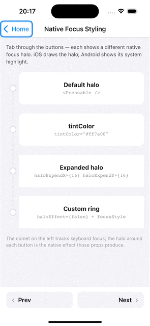
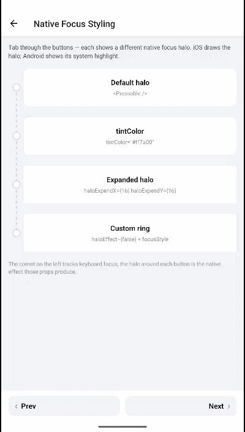

# Native focus indicators

Each platform draws its own indicator on the focused view: the halo on iOS and the default focus highlight on Android. Both are on by default and drawn by the system, separately from JS styles. Styles driven by focus state are covered in [Focus styles and events](./pressable-focus.md).

| iOS | Android |
| --- | --- |
|  |  |

## How it works

The indicator is drawn on the native container around the component, the same view that receives `containerStyle` (see [two style layers](./pressable-focus.md#styles)). Each platform has its own props, and `tintType` covers both:

| Platform | Indicator | Props |
| :-- | :-- | :-- |
| iOS | Halo ring (`UIFocusHaloEffect`) | `haloEffect`, `tintColor`, `haloCornerRadius`, `haloExpendX`, `haloExpendY` |
| Android | Default focus highlight (`View.setDefaultFocusHighlightEnabled`) | `defaultFocusHighlightEnabled` |
| Both | Either of the above | `tintType` |

Platform props have no effect on the other platform.

### iOS halo

On iOS, the focused view gets a halo: a ring around its bounds, drawn by the system. `tintColor` sets the ring color:

```tsx
<K.Pressable tintColor="dodgerblue" onPress={onPress}>
  <Text>Item</Text>
</K.Pressable>
```

The halo follows the view bounds. `haloCornerRadius` rounds it, and `haloExpendX` / `haloExpendY` move it outward, in points. The radius is not taken from `borderRadius`, so a rounded component sets both:

```tsx
<K.Pressable
  style={{ borderRadius: 12 }}
  haloCornerRadius={12}
  haloExpendX={4}
  haloExpendY={4}
  onPress={onPress}
>
  <Text>Rounded button</Text>
</K.Pressable>
```

### Android default focus highlight

`defaultFocusHighlightEnabled` turns the system highlight on or off. Its look comes from the system and has no style props.

### Turning the indicator off

A custom focus style usually replaces the native indicator. `tintType="none"` turns it off on both platforms:

```tsx
<K.Pressable
  tintType="none"
  style={({ focused }) => [styles.button, focused && styles.focused]}
  onPress={onPress}
>
  <Text>Item</Text>
</K.Pressable>
```

To turn it off on one platform only: `haloEffect={false}` on iOS, `defaultFocusHighlightEnabled={false}` on Android. A disabled halo stays off on rounded (`borderRadius`) views too. `tintType="none"` also works on `K.Input`.

---

## Quick decision guide

| Need | API |
| :-- | :-- |
| System indicator as is | Nothing, it is on by default |
| Halo color (iOS) | `tintColor` |
| Halo that matches a rounded component (iOS) | `haloCornerRadius`, `haloExpendX` / `haloExpendY` |
| Custom focus style instead of the native indicator | `tintType="none"` with a `style` callback |
| Indicator off on one platform only | `haloEffect={false}` (iOS), `defaultFocusHighlightEnabled={false}` (Android) |

---

## Props

| Prop | Platform | Type | Default | Description |
| :-- | :-- | :-- | :-- | :-- |
| `haloEffect` | iOS | `boolean` | `true` | Halo ring on focus. |
| `tintColor` | iOS | `ColorValue` | — | Halo color. |
| `haloCornerRadius` | iOS | `number` | — | Corner radius of the halo, in points. When unset, the system draws its default halo. |
| `haloExpendX` | iOS | `number` | `0` | Horizontal expansion of the halo beyond the view bounds, in points. |
| `haloExpendY` | iOS | `number` | `0` | Vertical expansion of the halo beyond the view bounds, in points. |
| `defaultFocusHighlightEnabled` | Android | `boolean` | `true` | System focus highlight on the focused view. |
| `tintType` | Both | `'default' \| 'none'` | `'default'` | `'none'` turns off the native indicator on both platforms. |
| `roundedHaloFix` | iOS | `boolean` | — | Deprecated, no effect. A disabled halo now stays off on rounded views without it. Removed in the next major version. |

---

## Related

- [Focus styles and events](./pressable-focus.md): `style` and `containerStyle` callbacks, render props, hooks
- [Component overview → common focus props](../components/overview.md#common-focus-props)

---

← [Focus styles and events](./pressable-focus.md) · [Programmatic focus →](./programmatic-focus.md)
