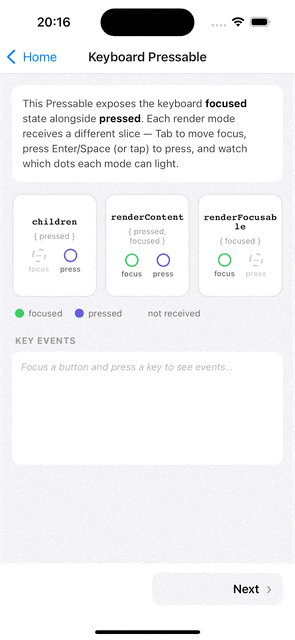
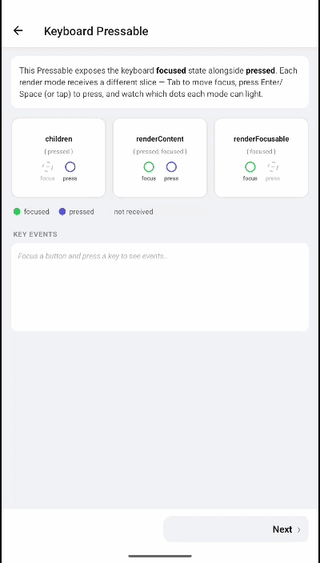

# Focus styles and events

Keyboard-focusable components report focus through events and pass the focus state to styles and content. This guide covers `K.Pressable` and components created with `withKeyboardFocus`. `K.View` supports only the focus events, `focusStyle`, and `useIsViewFocused`.

| iOS | Android |
| --- | --- |
|  |  |

## How it works

### Focus events

Focus handling and styling are built around the keyboard focus events: `onFocus`, `onBlur`, and `onFocusChange`. The events fire when keyboard focus moves in or out of the component (`Tab`, `Shift + Tab`, arrow keys), not on press:

```tsx
<K.Pressable
  onFocus={() => console.log('focused')}
  onBlur={() => console.log('blurred')}
  onFocusChange={(isFocused) => console.log({ isFocused })}
  onPress={onPress}
>
  <Text>Item</Text>
</K.Pressable>
```

### Styles

Instead of tracking these events in component state, styles can react to focus directly. The `style` and `containerStyle` props accept callbacks that receive the current `{ focused, pressed }` state:

```tsx
<K.Pressable
  style={({ focused, pressed }) => [
    styles.button,
    focused && styles.focused,
    pressed && styles.pressed,
  ]}
  containerStyle={styles.container}
  onPress={onPress}
>
  <Text>Item</Text>
</K.Pressable>
```

Keyboard focus lives on a native container view around the component. For this reason, a focusable component has two style layers. Inside, `K.Pressable` simply looks like this:

```tsx
// Inside K.Pressable (simplified)
<K.BaseView style={containerStyle}>   {/* keyboard focus, focus events, iOS halo */}
  <Pressable style={style}>           {/* touch and press handling */}
    {children}
  </Pressable>
</K.BaseView>
```

### Focus-aware content

Content that changes with focus, such as a label or an icon, can read the state in two ways.

**Render props.** `renderContent` and `renderFocusable` render the children from the current state:

```tsx
<K.Pressable
  onPress={onPress}
  renderContent={({ focused, pressed }) => (
    <Text style={[focused && styles.focusedText, pressed && styles.pressedText]}>
      Item
    </Text>
  )}
/>
```

`renderContent` works with components that take a function as `children`, such as `Pressable`, and receives `{ focused, pressed }`. `renderFocusable` works with any component, such as `TouchableOpacity`, and receives `{ focused }`:

```tsx
const KeyboardTouchable = withKeyboardFocus(TouchableOpacity);

<KeyboardTouchable
  onPress={onPress}
  renderFocusable={({ focused }) => (
    <Text style={focused && styles.focusedText}>Item</Text>
  )}
/>
```

**Hooks.** Alternatively, `useIsViewFocused` and `useIsViewPressed` read the state inside a nested component:

```tsx
import { K, useIsViewFocused, useIsViewPressed } from 'react-native-external-keyboard';

const Label = () => {
  const focused = useIsViewFocused();
  const pressed = useIsViewPressed();
  return (
    <Text style={[focused && styles.focusedText, pressed && styles.pressedText]}>
      Item
    </Text>
  );
};

<K.Pressable onPress={onPress}>
  <Label />
</K.Pressable>
```

---

## Quick decision guide

| Need | API | Note |
| :-- | :-- | :-- |
| Style of the pressable on focus or press | `style` callback | The common case |
| Style of the outer container, such as a focus ring | `containerStyle` callback | Also re-renders on touch press |
| Content that changes with focus, written inline | `renderContent` / `renderFocusable` | Re-renders the whole `K.Pressable` |
| Focus state in a nested component, without passing it down as props | `useIsViewFocused` / `useIsViewPressed` | Re-renders only the component that calls the hook |

---

## Related

- [Native focus indicators](./focus-styling.md): iOS halo, Android default focus highlight
- [Programmatic focus](./programmatic-focus.md): focus from a `ref`
- [Component overview → withKeyboardFocus](../components/overview.md#withkeyboardfocus): full props table
- [API reference → Hooks](../api/overview.md#hooks): `useIsViewFocused`, `useIsViewPressed` signatures
- [API reference → Types](../api/overview.md#types): `InteractionState`, `FocusStyle`

---

← [Getting started](../getting-started/getting-started.md) · [Native focus indicators →](./focus-styling.md)
