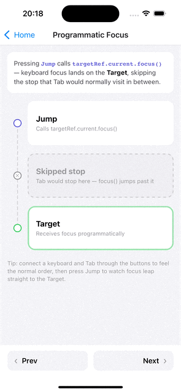
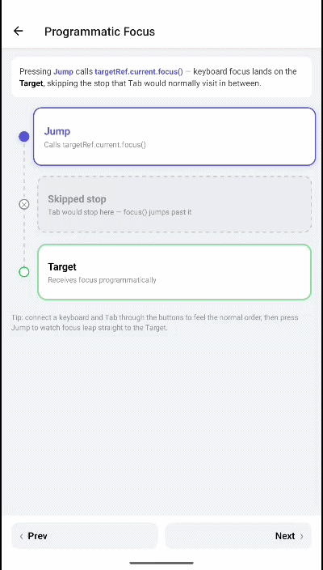

# Programmatic focus

Focus sometimes moves in response to app logic: after opening a panel, submitting a form, or restoring a previous position. Keyboard-focusable components expose focus methods through their `ref` for this.

| iOS | Android |
| --- | --- |
|  |  |

## How it works

### Focus methods

The `ref` of `K.Pressable`, `K.View`, `K.BaseView`, and `withKeyboardFocus` components has three focus methods:

| Method | Moves |
| :-- | :-- |
| `focus()` | Keyboard and screen reader focus |
| `keyboardFocus()` | Keyboard focus only |
| `screenReaderFocus()` | Screen reader focus only (VoiceOver / TalkBack) |

`focus()` covers both keyboard and screen reader users, so it fits most cases:

```tsx
import { useRef } from 'react';
import { Text } from 'react-native';
import { K, type KeyboardFocus } from 'react-native-external-keyboard';

export function Form({ onSubmit }: { onSubmit: () => void }) {
  const submitRef = useRef<KeyboardFocus>(null);

  return (
    <>
      <K.Pressable onPress={() => submitRef.current?.focus()}>
        <Text>Skip to Submit</Text>
      </K.Pressable>

      <K.Pressable ref={submitRef} onPress={onSubmit}>
        <Text>Submit</Text>
      </K.Pressable>
    </>
  );
}
```

`K.Input` passes its `ref` to the inner `TextInput`, so it has the standard `TextInput` methods, such as `focus()` and `blur()`.

### Focus on mount

For focus on mount, the `autoFocus` prop needs no `ref`:

```tsx
<K.Pressable autoFocus onPress={onPress}>
  <Text>Focused on mount</Text>
</K.Pressable>
```

A `ref` covers focus moves after mount, such as after a press, a navigation, or a state change.

### Native view methods

Other properties of the `ref` go to the native container view (the `K.BaseView` from the [two style layers](./pressable-focus.md#styles)), so standard view methods work on the same `ref`:

```tsx
ref.current?.measure((x, y, width, height) => {
  /* … */
});
```

The wrapped component itself, such as the inner `Pressable`, is available through a separate `componentRef`:

```tsx
const componentRef = useRef<View>(null);

<K.Pressable componentRef={componentRef} onPress={onPress}>
  <Text>Item</Text>
</K.Pressable>
```

---

## Quick decision guide

| Need | API |
| :-- | :-- |
| Focus on mount | `autoFocus` |
| Focus after an event, for keyboard and screen reader users | `ref.current?.focus()` |
| Keyboard focus only, screen reader focus stays in place | `ref.current?.keyboardFocus()` |
| Screen reader focus only | `ref.current?.screenReaderFocus()` |
| Native view methods, such as `measure` | The same `ref` |
| The wrapped component instance | `componentRef` |

---

## Related

- [Focus styles and events](./pressable-focus.md): focus events, `style` and `containerStyle` callbacks
- [API reference → Imperative ref](../api/overview.md#imperative-ref-keyboardfocus)

---

← [Native focus indicators](./focus-styling.md) · [Text input →](./text-input.md)
