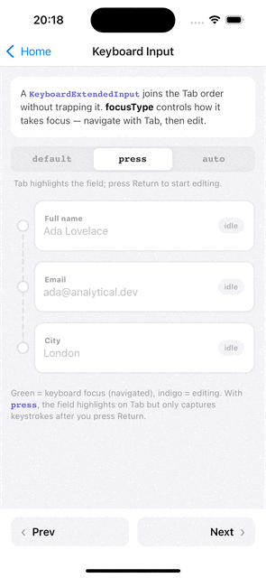
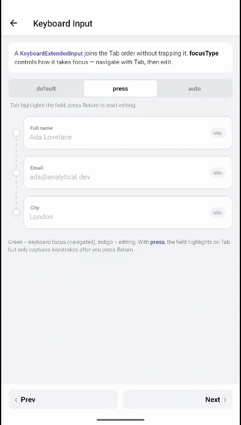

# Text input

`K.Input` is a `TextInput` with keyboard focus support: it joins `Tab` and arrow-key navigation, controls how the field starts and stops editing on keyboard focus, and fires `onSubmitEditing` for multiline fields. It accepts all `TextInput` props; the props type is `KeyboardInputProps`.

| iOS | Android |
| --- | --- |
|  |  |

## How it works

### Focus and editing

Keyboard focus on a text field and text editing in it are related but separate: focus makes the field the current stop of keyboard navigation, and editing shows the cursor and takes the typed text. `focusType` sets when editing starts, and `blurType` sets when it stops.

Like `K.Pressable`, `K.Input` has two layers. Keyboard focus lives on a native wrapper around the `TextInput`:

```tsx
// Inside K.Input (simplified)
<TextInputFocusWrapperNative style={[containerStyle, containerFocusStyle]}> {/* keyboard focus, iOS halo */}
  <TextInput ref={ref} style={[style, focusStyle]} />                       {/* text editing */}
</TextInputFocusWrapperNative>
```

The `ref` goes to the inner `TextInput`, so the standard `focus()` and `blur()` methods work as usual.

### Start of editing: `focusType`

| Value | Editing starts |
| :-- | :-- |
| `'default'` | Platform default: on Android when keyboard focus reaches the field, on iOS after a press |
| `'press'` | After `Space` is pressed on the focused field |
| `'auto'` | As soon as keyboard focus reaches the field |

```tsx
<K.Input focusType="auto" value={text} onChangeText={setText} />
```

### End of editing: `blurType` *(iOS)*

| Value | When keyboard focus moves away |
| :-- | :-- |
| `'default'` | The field stays in editing mode, and typing still goes to it |
| `'disable'` | The field stops editing |
| `'auto'` | The system decides |

```tsx
<K.Input blurType="disable" value={text} onChangeText={setText} />
```

### Focus styles

`style` and `containerStyle` are plain styles. `focusStyle` and `containerFocusStyle` apply on top of them while the field has keyboard focus, and `onFocusChange` reports the change:

```tsx
<K.Input
  value={text}
  onChangeText={setText}
  style={styles.input}
  focusStyle={{ borderColor: 'dodgerblue', borderWidth: 2 }}
  onFocusChange={(isFocused) => console.log({ isFocused })}
/>
```

The native indicator props (`haloEffect`, `tintColor`, `defaultFocusHighlightEnabled`, `tintType`) work as described in [Native focus indicators](./focus-styling.md).

### Multiline submit

A standard multiline `TextInput` does not fire `onSubmitEditing` on `Enter`. `K.Input` fires it for multiline fields too, for "send on Enter" flows:

```tsx
<K.Input
  multiline
  value={message}
  onChangeText={setMessage}
  submitBehavior="blurAndSubmit"
  onSubmitEditing={(e) => send(e.nativeEvent.text)}
/>
```

`submitBehavior="blurAndSubmit"` ends editing on submit. Without `submitBehavior`, the field follows `blurOnSubmit`, which defaults to `true`.

---

## Quick decision guide

| Need | API |
| :-- | :-- |
| Editing as soon as keyboard focus reaches the field | `focusType="auto"` |
| Editing only after `Space` | `focusType="press"` |
| Editing ends when keyboard focus leaves (iOS) | `blurType="disable"` |
| Send on `Enter` in a multiline field | `multiline` with `onSubmitEditing` |
| Style while focused | `focusStyle`, `containerFocusStyle` |
| Field skipped by keyboard navigation and not editable | `focusable={false}` |
| Custom Tab and arrow-key order | `orderId` / `order*`, `orderIndex`, `lockFocus` ([Focus order](./focus-order.md)) |

---

## Props

`K.Input` accepts all `TextInput` props, the [focus order](./focus-order.md) props, and:

| Prop | Type | Default | Description |
| :-- | :-- | :-- | :-- |
| `focusType` | `'default' \| 'press' \| 'auto'` | `'default'` | When editing starts on keyboard focus. |
| `blurType` | `'default' \| 'disable' \| 'auto'` | `'default'` | (iOS) What happens to editing when keyboard focus moves away. |
| `focusable` | `boolean` | `true` | Keyboard focus on the field. `false` also makes the field not editable. |
| `onFocusChange` | `(isFocused: boolean) => void` | — | Called when the field gains or loses keyboard focus. |
| `containerStyle` | `StyleProp<ViewStyle>` | — | Style of the native wrapper. |
| `focusStyle` | [`FocusStyle`](../api/overview.md#focusstyle) | — | Style of the `TextInput` while focused. |
| `containerFocusStyle` | [`FocusStyle`](../api/overview.md#focusstyle) | — | Style of the native wrapper while focused. |
| `haloEffect`, `tintColor`, `defaultFocusHighlightEnabled`, `tintType` | | | Native indicator props. See [Native focus indicators](./focus-styling.md#props). |

---

## Related

- [Native focus indicators](./focus-styling.md): iOS halo, Android default focus highlight
- [Focus order](./focus-order.md): custom `Tab` and arrow-key order
- [Component overview → K.Input](../components/overview.md#kinput)

---

← [Programmatic focus](./programmatic-focus.md) · [Focus order →](./focus-order.md)
